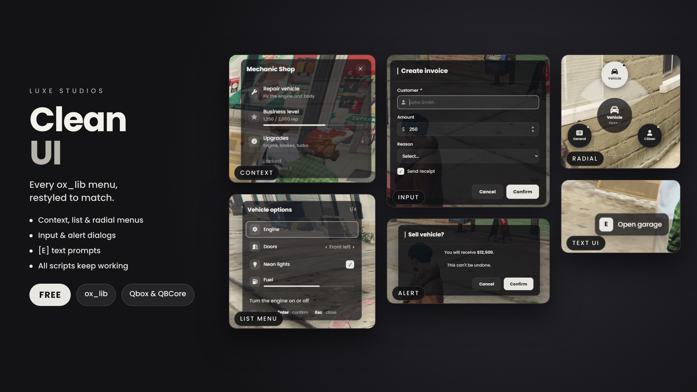

# Luxe Clean UI
**Every ox_lib menu, restyled in the Luxe Clean style.** Free, by Luxe Studios.
ox_lib still runs all the logic, so every script on your server keeps working exactly the same.

## What it restyles
- **Context menus**: icons, descriptions, progress bars, hover info, sub-menus
- **List menus**: arrow keys, scroll values, checkboxes
- **Radial menu** (qbx_radialmenu / `lib.addRadialItem`): point to pick, number keys, pages, sub-menus
- **Input dialogs**: text, number, select, multi-select, slider, checkbox, colour, date, time
- **Alert / confirm dialogs**
- **Text UI**: `[E] Open garage` prompts with a key badge

Walk and drive while menus are open (not while typing). Glass or solid, and it follows each player's colour and style from
[Luxe Clean Notify & Progress](https://github.com/Luxe-Studios/Luxe-Clean-Progress-Notify) or [Luxe Clean HUD](https://luxestudios.shop).

> Pair it with **Luxe Clean Notify & Progress** for notifications and progress bars, and all of ox_lib matches.

## Install
1. Copy **`luxe_cleanui`** into your resources and add `ensure luxe_cleanui` after `ox_lib`.
2. Hook ox_lib:
   - **ox_lib v3.42.2:** copy the `ox_lib_v3.42.2/resource` folder over your `ox_lib/resource`.
   - **Any other version:** add the snippet from [`luxe_cleanui/README.md`](luxe_cleanui/README.md) to the top of 6 files, plus one line in `main.lua`.
3. Restart the **whole server**.
4. Try it: `/uitest context`, `/uitest menu`, `/uitest input`, `/uitest alert`, `/uitest textui`.

If `luxe_cleanui` is stopped, ox_lib draws its normal menus again.

## Config
`luxe_cleanui/config.lua`: accent colour, glass / solid, walking while menus are open, text UI position, radial style and size.

## License
Free to use and edit for your server. Please don't sell or re-upload it as your own. See [LICENSE.md](LICENSE.md).

## Support
[Discord](https://discord.gg/ayQTxhaNv9) · [luxestudios.shop](https://luxestudios.shop)
